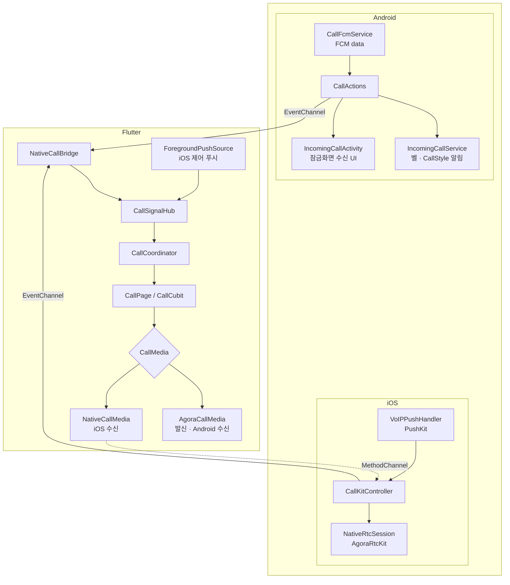
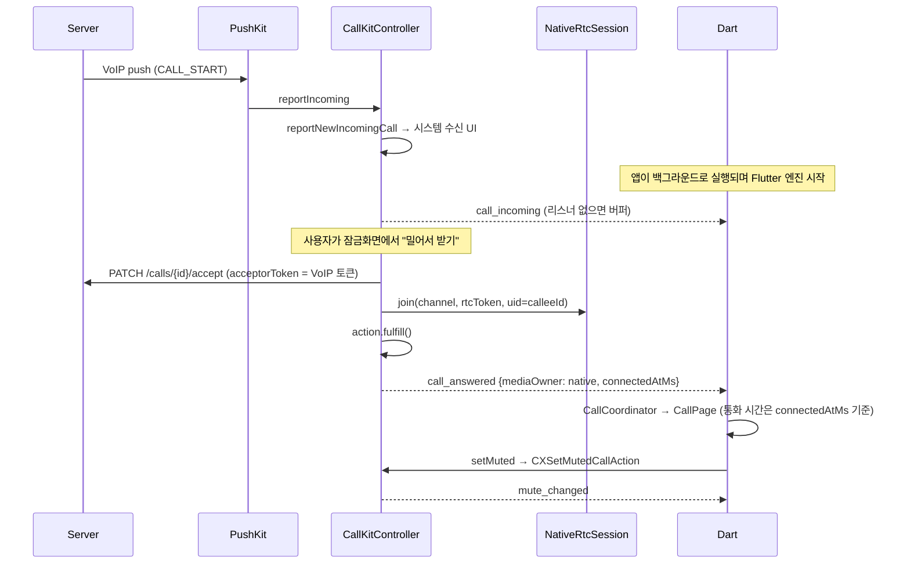
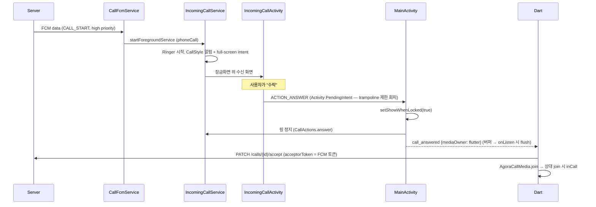
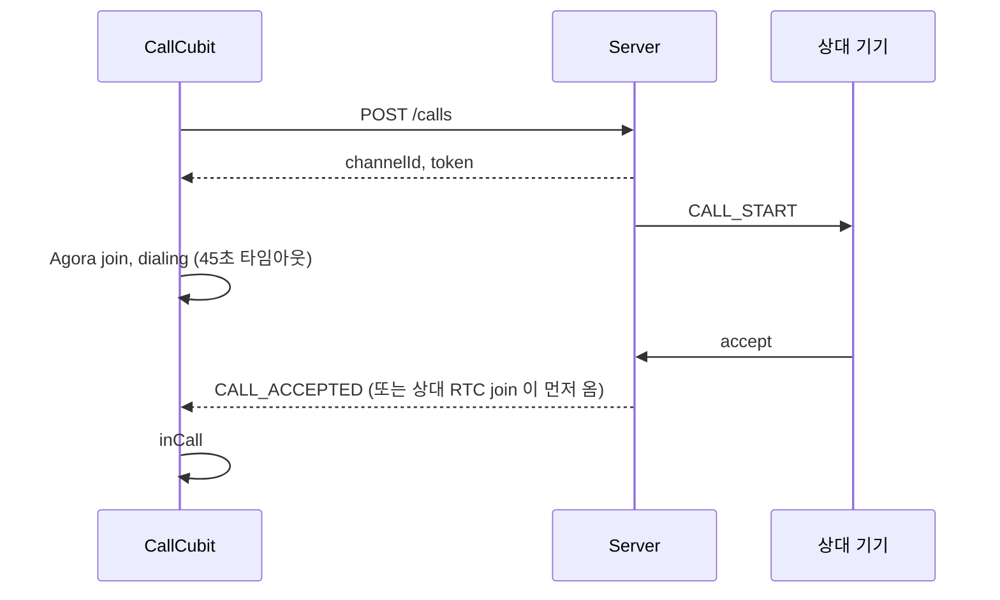

# Flutter VoIP Call

Flutter 앱에 **1:1 음성 통화**를 붙이는 클라이언트 코어입니다.
앱이 꺼져 있거나 화면이 잠겨 있어도 일반 전화처럼 울리고, 받으면 바로 통화가 연결됩니다.

- **iOS** — PushKit(VoIP 푸시) → CallKit → 네이티브 Agora
- **Android** — FCM 고우선순위 data 메시지 → 포그라운드 서비스 + 잠금화면 Activity → Flutter Agora
- **Flutter** — Clean Architecture, Cubit 상태 머신, 네이티브와는 EventChannel / MethodChannel

> 학원 차량 안전 서비스 앱에서 학부모 ↔ 선생님 간 "안심통화" 기능을 클라이언트 단독으로 구현했던 경험을 바탕으로,
> 회사 코드·키·서버 주소 없이 처음부터 다시 정리한 저장소입니다. 서버는 포함하지 않고, 클라이언트가 기대하는 계약만
> [`docs/server-contract.md`](docs/server-contract.md) 에 정리했습니다.

---

## 핵심 설계

### 1. 미디어 소유권 — 누가 Agora 채널에 들어가는가

| 상황 | 채널에 들어가는 쪽 | 수락 API 호출 |
|---|---|---|
| 발신 (iOS / Android) | Dart `agora_rtc_engine` | – |
| 수신 Android | Dart `agora_rtc_engine` | Dart |
| 수신 iOS (CallKit) | **네이티브 AgoraRtcKit** | **네이티브** |

iOS 는 잠금화면에서 CallKit 으로 전화를 받는 순간 `CXAnswerCallAction` 을 처리해야 하는데, 앱이 종료돼 있었다면
이 시점에 Flutter 엔진과 Dart Agora 가 준비돼 있다는 보장이 없습니다. 그래서 iOS 수신 통화는 네이티브가 채널에 들어가고,
Flutter 화면은 나중에 붙어서 음소거/스피커만 제어합니다.

규칙은 하나로 정했습니다: **미디어를 소유한 쪽이 수락 API 를 호출한다.**
Dart 에서는 이를 `MediaOwner` 와 `CallMedia` 인터페이스(`AgoraCallMedia` / `NativeCallMedia`)로 감춰서,
통화 상태 머신(`CallCubit`)은 미디어가 어디서 돌고 있는지 모릅니다.

### 2. 콜드 스타트에서 이벤트를 잃지 않기

알림에서 "수락"을 누르면 앱 프로세스 → `MainActivity` → FlutterEngine → Dart `main()` 순서로 올라옵니다.
네이티브의 "수락됨" 이벤트는 Dart 가 EventChannel 을 listen 하기 **전에** 발생합니다.

- 네이티브(`CallEventStreamer`, Kotlin/Swift 동일 구조): sink 가 없으면 이벤트를 버퍼에 쌓고, `onListen` 즉시 flush. 60초 지난 이벤트는 버림.
- Dart(`CallCoordinator`): 이벤트는 받았는데 `MaterialApp` 의 Navigator 가 아직 없으면 보류했다가 다음 프레임에 통화 화면을 연다.
- 통화 화면이 뜨기 전에 상대가 끊었으면(`CallSignalHub.hasEnded`) 화면을 열자마자 종료.

고정 지연(`postDelayed(300)`, `Future.delayed`) 없이 "준비됨" 신호에만 의존합니다.

### 3. 상태의 출처를 하나로

- **종료 경로** — 내가 끊음 / 상대가 끊음 / 링 타임아웃 / RTC 연결 실패 / 화면 dispose 가 겹쳐도 `CallCubit._finish()` 한 곳에서 한 번만 정리.
  서버 종료 API 를 부를지(`notifyServer`)는 종료 원인이 결정.
- **음소거** — iOS 에서는 CallKit 이 출처. Flutter 버튼도 `CXSetMutedCallAction` 트랜잭션을 거쳐서,
  잠금화면 통화 UI 와 Flutter 화면이 같은 상태를 보게 함. Cubit 은 미디어가 보낸 `MediaMuteChanged` 이벤트로만 상태를 갱신.
- **중복 신호** — 알림 버튼과 전체화면 버튼이 동시에 눌리거나, 같은 `CALL_END` 가 VoIP/FCM 두 경로로 오는 경우
  `CallSignalHub` 가 `(신호, channelId)` 단위로 한 번만 내보냄.

---

## 구조



```
lib/
├── app/                      # DI(injectable), 설정(--dart-define), 데모 홈
├── core/                     # Failure, 로그, 세션, 권한
└── features/call/
    ├── domain/               # CallSession, CallSignal, CallEndReason, UseCase, Repository 인터페이스
    ├── data/                 # Retrofit CallApi, Repository 구현, FCM 연동
    ├── native/               # NativeCallBridge, 이벤트 파싱 (Kotlin/Swift 와 계약 공유)
    ├── signaling/            # CallSignalHub — 신호 정규화·중복 제거
    ├── media/                # CallMedia 추상화 (Dart Agora / iOS 네이티브)
    └── presentation/         # CallCoordinator, CallCubit, CallPage

android/app/src/main/kotlin/dev/sintaek/voipcall/
├── MainActivity.kt           # 채널 등록, 수락 인텐트 처리, 잠금화면 표시
└── call/                     # CallFcmService, IncomingCallService, IncomingCallActivity,
                              # CallActions, CallEventStreamer, Ringer, NativeCallApi ...

ios/Runner/Call/              # VoIPPushHandler, CallKitController, NativeRtcSession,
                              # CallEventStreamer, CallMethodHandler, NativeCredentialStore ...
```

---

## 통화 흐름

### iOS 수신 (앱 종료 상태)



### Android 수신 (화면 꺼짐)



### 발신



---

## 실서비스에서 겪었던 문제

실서비스 개발 중 실제로 부딪혔던 문제들과, 이 저장소에서 그 부분이 어떻게 반영되어 있는지입니다.

**TestFlight 에서만 VoIP 푸시가 오지 않음**
개발 빌드에서는 잘 오던 VoIP 푸시가 TestFlight 빌드에서 오지 않았습니다. 원인은 Development 프로비저닝 프로파일로 서명돼
sandbox 환경의 VoIP 토큰이 발급되고 있었던 것. 서버는 production APNs 로 보내고 있었기 때문에 토큰이 맞지 않았습니다.
Distribution 프로비저닝 프로파일을 수동으로 만들어 서명하고 해결했습니다.

**Android 에서 통화 푸시마다 FlutterEngine 이 하나 더 뜨며 ANR**
`firebase_messaging` 의 백그라운드 핸들러가 통화 푸시에도 Dart isolate 를 띄우면서 메인 엔진과 충돌했습니다.
통화 푸시는 네이티브(`CallFcmService`)가 처리하고 끝내도록 분리하고, 충돌하던 Firebase 수신 경로를 정리했습니다.
→ `CallFcmService`, `main.dart` 주석, `AndroidManifest.xml` 의 서비스 교체 참고.

**앱 상태(포그라운드 / 백그라운드 / 종료 / 잠금)마다 다르게 깨지는 Android 수신**
같은 "수락"이라도 앱 상태에 따라 Dart 가 EventChannel 을 listen 하는 시점이 달라서, 콜드 스타트에서 수락 이벤트가
Flutter 에 전달되지 않는 경우가 있었습니다. 잠금화면 전용 네이티브 수신 화면과 이벤트 버퍼링·flush 로 해결했습니다.
→ `IncomingCallActivity`, `CallEventStreamer`, `CallCoordinator`.

**CallKit ↔ Agora 음소거·스피커 동기화**
iOS 수신 통화는 CallKit UI(잠금화면 포함)와 Flutter 화면 양쪽에서 음소거·스피커를 바꿀 수 있어서, 두 화면과 실제 Agora 상태를
맞추는 작업이 필요했습니다. → `CallKitController` 의 `CXSetMutedCallAction`, 오디오 라우트 옵저버.

## 실서비스 코드 대비 바꾼 점

다시 정리하면서 구조적으로 손본 부분입니다.

- **푸시 payload 에서 액세스 토큰 제거** — 네이티브가 API 를 부르기 위해 서버가 푸시에 액세스 토큰을 실어 보내던 구조를,
  Flutter 가 로그인/갱신 시 네이티브 저장소(iOS Keychain `AfterFirstUnlock`, Android SharedPreferences)에 동기화하는 방식으로 변경.
- **수락 진입점 단일화** — 알림 버튼 / 전체화면 Activity / MainActivity 각자 하던 링 정지·캐시 정리·Flutter 통지를 `CallActions` 로 모음.
- **고정 지연 제거** — `onListen` flush + Navigator 준비 대기.
- **분기 대신 추상화** — 통화 화면 곳곳의 `isNativeAccepted` 분기와 1초 주기 상태 폴링을 `CallMedia` 인터페이스와 이벤트로 대체.
- **CallKit 종료 처리** — 서버 종료 API 가 실패하면 `CXEndCallAction` 을 fail 시키던 것을, 즉시 fulfill 하고 서버 통지는 background task 로 분리
  (fail 하면 시스템 통화 UI 가 남음).
- **벨소리 단일 소유** — 알림 채널 사운드 / 서비스 / Activity 가 각각 울리던 것을 `Ringer` 하나로. 사용자 벨소리 모드(무음·진동) 존중.
- **PushKit 정책 방어** — 제어 메시지가 VoIP 푸시로 와도 CallKit 리포트 후 즉시 종료.
- **설정 외부화** — Agora App ID, API 주소를 `--dart-define` 으로.

## 알려진 한계

- **Android 통화 중 백그라운드**: 통화 중에는 포그라운드 서비스가 없어서, 앱을 백그라운드로 보내면 Android 11+ 의
  백그라운드 마이크 제한에 걸릴 수 있습니다. 통화 중 FGS(`microphone`) 추가가 다음 작업입니다.
- 발신 통화는 CallKit(`CXStartCallAction`)에 리포트하지 않습니다.
- 네이티브가 쓰는 액세스 토큰이 만료되면 거절/수락 API 가 실패합니다 (토큰 갱신은 앱 쪽 책임).
- 1:1 음성 통화만 지원합니다.

---

## 실행

**요구 사항**: Flutter 3.38+ (Dart 3.10), Xcode 16+, Android Studio, Agora 프로젝트, Firebase 프로젝트, 실기기 2대

```sh
# 1) 설정
cp env/dev.example.json env/dev.json      # API_BASE_URL, AGORA_APP_ID, DEMO_ACCESS_TOKEN, DEMO_USER_ID

# 2) Firebase — android/app/google-services.json, ios/Runner/GoogleService-Info.plist 추가
flutterfire configure                     # 또는 콘솔에서 직접 내려받기

# 3) 코드 생성 (freezed / json_serializable / retrofit / injectable)
flutter pub get
dart run build_runner build -d

# 4) 실행
flutter run --dart-define-from-file=env/dev.json
```

iOS 는 Xcode 에서 Signing Team 을 지정하고, Capabilities 에 **Push Notifications** 와 **Background Modes → Voice over IP**
가 켜져 있는지 확인합니다 (`Runner.entitlements`, `Info.plist` 에 포함됨). VoIP 푸시 전송에 필요한 APNs 키/인증서는 서버 설정입니다.

```sh
flutter test        # CallCubit 상태 전이, 신호 중복 제거, 네이티브 이벤트 파싱
```

## 기술 스택

Flutter · Dart 3 (sealed class, pattern matching) · flutter_bloc (Cubit) · freezed · injectable / get_it · Retrofit / Dio · dartz ·
agora_rtc_engine · firebase_messaging · Kotlin (Coroutines, OkHttp) · Swift (CallKit, PushKit, AgoraRtcKit, async/await)
